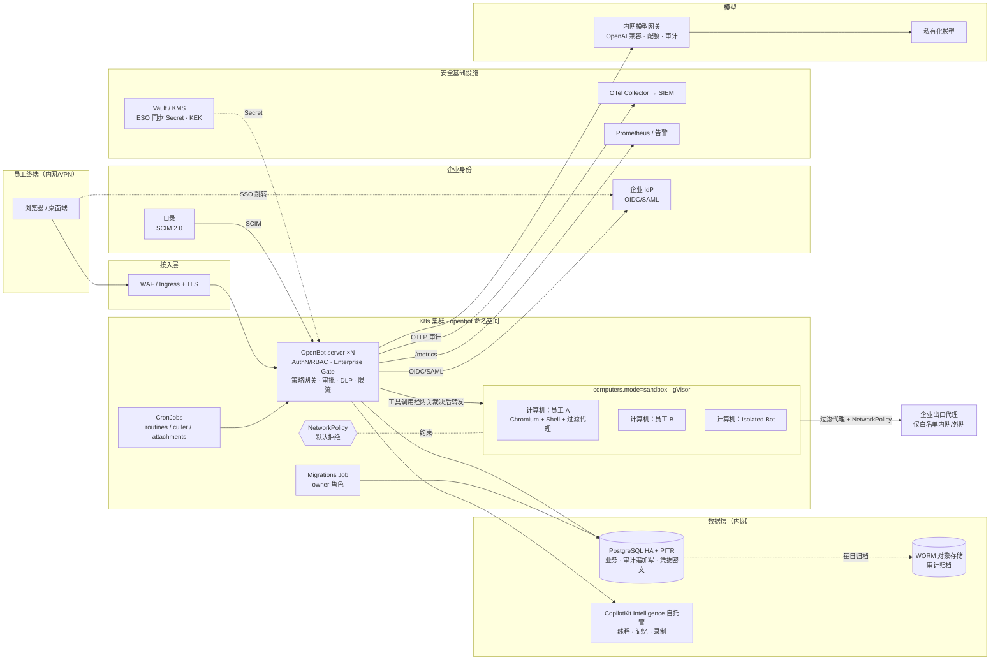

# OpenBot 企业级安全改造任务书

| 项目 | 内容 |
| --- | --- |
| 仓库 | https://github.com/PenguinAlston/OpenBot（fork 自 https://github.com/CopilotKit/OpenBot） |
| 调研基线 | `main` @ `c396a5f`（提交时间 2026-10-31 10:17 PDT，即 2026-11-01 01:17 北京时间） |
| 目标 | 把 OpenBot 改造为**仅在企业内网运行**、具备**安全围栏 / 安全边界 / 用户与权限管理**的企业级内部应用 |
| 读者 | 负责实施的开发人员 / 编码 Agent |
| 编写方式 | 只读调研：结论均来自源码与仓库文档，引用路径以仓库根目录为准。代码里没找到的内容统一标注 **未发现 / 需确认**，不推测 |
| 工作量说明 | 文中所有「人天」均为**粗略估算**，按熟悉 TypeScript/Bun/Hono/Drizzle/K8s 的中级工程师计算，未含评审、联调等待与测评机构排期 |

---

## 0. 结论速览

1. **基础比预想的好**。上游已经实现：企业 IdP 登录（Google/Microsoft/Okta 环境变量 + 运行时注册 SAML/OIDC）、**SCIM 2.0 开通/停用**、admin/user 两级角色、按组织/角色/组配置的「能力开关」、强制 SSO、按组的网络出口策略、MCP/模型白名单、CEL 动作策略网关（失败即拒绝）、人工审批与内置高危动作移交、追加写审计（数据库触发器）+ CSV 导出 + OTLP 推送到 SIEM、凭据 AES-GCM 加密、每人/每 Bot 独立计算机（supervisor 或 Helm `sandbox` 模式）、gVisor、K8s NetworkPolicy、发布镜像带 SBOM 与 provenance。
2. **最大的风险在部署默认值和数据外发，不在缺功能**：默认动作策略是 `allow: ["true"]`；Helm 默认 `computers.mode: shared`（同一台计算机上 Bot 之间互相能读文件）、`networkPolicy.enabled: false`、API Pod `runAsNonRoot: false`；对话线程、记忆和录制都存放在 **CopilotKit Intelligence**（外部 SaaS，或需要许可证的自托管），模型默认走 OpenAI。
3. **真正缺的能力**：组织-部门-项目多级权限（目前只有 admin/user + 扁平目录组）；审批只能由本人决定（没有第三方审批人，也没有多级审批）；DLP 只识别凭据、不识别个人信息；没有限流、Token 计量和配额；KEK 只是一个环境变量（不对接 KMS，也没有轮换工具）；审计没有哈希链和 WORM 存储；没有 Prometheus 指标；SPIRE 身份已签发但「没有任何地方校验」；会话时长不可配置。
4. **P0（上线必需）**：生产化 Helm 基线（sandbox 隔离 + NetworkPolicy + 非 root + gVisor）、企业 IdP + SCIM + 强制 SSO、默认策略收紧、出口白名单、数据驻留（自托管 Intelligence + 内网模型网关 + 关闭外部连接器与遥测）、密钥托管、审计留存与 SIEM 对接、备份恢复、上线前渗透测试。

---

## 1. 现状盘点（基于代码）

### 1.1 系统组成与部署形态

| 组件 | 说明 | 证据 |
| --- | --- | --- |
| app（React/Vite） | 前端，含 `/admin/*` 管理页 | `app/src/routes/_authed/admin/` |
| server（Hono + Bun，端口 3001） | API、CopilotKit runtime、认证、角色、策略网关、审计、凭据、插件、组件 | `server/src/app.ts`、`server/src/index.ts`、`docs/architecture.md` |
| agent-computer（端口 4100） | Chromium、`/workspace`、Shell、文件工具，需要 `COMPUTER_TOKEN` | `agent-computer/`、`docs/architecture.md` §Computers |
| supervisor（4300/4500） | 持有 Docker socket，为每人/每个 Isolated Bot 创建容器，接口仅 ensure/stop/reset/list，Bearer 比较为常数时间 | `supervisor/src/index.ts`、`supervisor/src/authorisation.ts` |
| PostgreSQL | 业务数据、审计、凭据、策略、授权 | `server/src/db/schema/*.ts`（约 122 张表）、`server/drizzle/*.sql` |
| CopilotKit Intelligence | **外部强依赖**：线程、记忆、实时网关、Learning 录制 | `server/src/intelligence-client.ts`、`server/src/memory/intelligence.ts`、`docs/configuration.md` §Required |
| 单镜像 | app+API+Chromium，可选 `EMBEDDED_POSTGRES=on`；**不含** supervisor 和 routines 定时任务 | `Dockerfile`、`docs/deployment.md` |
| Helm Chart | server Deployment（默认 2 副本，带 HPA/PDB）、migrations Job、routines/attachments/culler CronJob、computer `shared`/`sandbox`/`external` 三种模式、NetworkPolicy、ExternalSecret | `charts/openbot/values.yaml`、`charts/openbot/templates/**` |
| SPIRE | `docker-compose.yml` 中可选；supervisor 为计算机注册 `spiffe://<domain>/person|bot/<id>` | `spire/server.conf`、`spire/agent.conf`、`supervisor/src/identity.ts` |

### 1.2 认证（AuthN）

- **登录方式**：Better Auth，环境变量支持 Google、Microsoft（`MICROSOFT_OAUTH_TENANT_ID`）、Okta；SAML/OIDC 在 `/admin/identity-providers` 运行时注册，按邮箱域名路由（`server/src/auth/index.ts`、`server/src/auth/identity-provider-store.ts`、`docs/configuration.md` §Authentication）。
- **IdP 归属**：IdP 属于整个部署，不属于注册它的管理员；删除注册者时置空、不级联删除（`server/src/db/schema/core.ts` 中 `ssoProviders.userId` 的注释）。
- **IdP 机密加密**：client secret 和 SAML 签名材料用 `KEY_ENCRYPTION_KEY` 加密后存储（`server/src/auth/encrypt-sso-config.ts`）；OAuth token 由 Better Auth 用 `BETTER_AUTH_SECRET` 加密。
- **准入控制**：`SIGNIN_ALLOWED_EMAIL_DOMAINS` 精确匹配并做 IDNA 规范化（`server/src/auth/email-domain.ts`）；与多租户 Microsoft tenant 同时配置时拒绝启动。
- **单用户模式防护**：没有 IdP 时必须设置 `OPENBOT_SINGLE_USER=true`；地址是公网时即使设置了也拒绝启动（`docs/configuration.md` L369-381、`server/src/config.ts`）。
- **强制 SSO**：`enterprise_settings.sso_required` 打开时，会终止非 SSO 用户的会话，`INITIAL_ADMIN_EMAILS` 作为破窗账号保留（`server/src/auth/sso-required.ts`、`server/src/admin/routes.ts` L243-314）。
- **离职处置**：删除用户时同时删除会话并把邮箱加入 `revoked_access`，会话创建前会再校验一次（`server/src/db/schema/core.ts` `revokedAccess`、`server/src/auth/index.ts` session.create.before）。
- **SCIM 2.0**：设置 `SCIM_BEARER_TOKEN` 后启用，支持 `_NEXT` 双 token 轮换；目录组写入 `users.groups`；停用账号时结束会话、加入拒绝列表、回收其授权的连接器凭据、停止其 Bot 计算机（`server/src/auth/scim.ts`、`server/src/db/schema/scim.ts`）。
- **会话**：使用 Better Auth 默认值（文档写的是「一周不用即过期」，`server/src/auth/index.ts` L625-632 读取 `sessionConfig.expiresIn`）。**未发现**可配置会话时长、空闲超时、并发会话上限的环境变量。
- **MFA**：**未发现** OpenBot 自带 MFA，依赖 IdP。
- **组织授权中心**：`OPENBOT_ORGANIZATION_AUTH_URL` 可以把另一个 OpenBot 部署作为员工身份与角色的权威来源（`server/src/auth/organization.ts`），组织会话 cookie 最长 7 天。

### 1.3 授权（AuthZ）与用户管理

- **角色只有两个**：`admin` 和 `user`（`server/src/auth/roles.ts` `OpenBotRole`）。路由守卫为 `createRequireUser` 和 `requireAdmin`（`server/src/auth/guards.ts`）。`INITIAL_ADMIN_EMAILS` 中的地址每次登录都会被提升为 admin，且不能在 People 页降级。
- **能力开关**（`/admin/enterprise`）：共 11 项，包括 `useBots`、`cloudBrowser`、`cloudNetwork`、`cloudComputer`、`localComputer`、`customRules`、`passwordManager`、`slackTeams`、`teamBots`、`ownerApps`、`isolatedComputers`（`server/src/admin/capabilities.ts`）。作用域分三层：organization 为基线，role 覆盖基线，group **只能放宽**（`server/src/db/schema/admin.ts` `capabilitySettings`）。执行点有三处：HTTP 网关 `server/src/admin/gate.ts`、计算机策略叠加层、以及包裹 store 的守卫（`server/src/admin/controls.ts` 头注释），读不到配置时一律拒绝。
- **模型白名单 / MCP 白名单**：`enterprise_settings.model_allowlist`、`mcp_allowlist`（`server/src/admin/settings-store.ts`、`server/src/admin/gate.ts` L238）。
- **频道访问**：由 `channel_memberships` 决定。`channels.allowed_groups` **只存储、不参与判断**（`docs/architecture.md` L173-177、`server/src/db/schema/core.ts` L292-301）。
  - ⚠️ **文档与代码不一致，需确认**：`docs/architecture.md` 和 `docs/configuration.md`（`channels.yaml` 一节）写「`users.groups` 不会被任何登录路径填充」；但 `server/src/auth/scim.ts` L160-177 显示 SCIM 会写入 `users.groups`。结论是：组数据**通过 SCIM 已经能到达**，但 `allowed_groups` 的强制执行**仍未实现**。
- **Bot 之间的调用**：`message_bot` 走 `plugin_grants` 授权，有深度/次数上限（`BOT_HANDOFF_MAX_DEPTH/PER_RUN`），由部署签名的运行断言防止 Bot 伪造调用来源（`server/src/agents/handoff-*.ts`、`server/src/agents/callback-token.ts`）。
- **组织层级**：**未发现**组织/部门/项目实体。`ssoProviders.organizationId` 只是 Better Auth SSO 插件的字段；`deployment_packages.tenantId` 指租户包，**不是**多租户数据隔离。

### 1.4 策略网关与安全边界（Boundaries）

- **网关流程**：解析目标 → 评估策略 → 写审计 → 放行后才调用计算机 → 失败时再写一行审计（`server/src/computer/gateway.ts`、`server/src/computer/policy.ts`）。
- **规则语言**：CEL + `contains()`/`matches()`，可用字段包括 tool、intent、bot、actor、page.url/host、element、command、file、mcp.server/tool/effect、initiator。deny 优先；失败即拒绝；配置有误时拒绝启动。支持 dry-run（`server/src/computer/policy-dry-run.ts`）。管理页为 `/admin/boundaries`。
- ⚠️ **默认策略是 `deny: []` + `allow: ["true"]`**（`docs/architecture.md` L68-73），即**默认全部放行**。
- **MCP**：先查授权，再走同一个策略引擎，最后写审计；未知工具和自定义服务器工具按「写操作」处理；自定义 MCP URL 有校验（`server/src/plugins/mcp.ts`、`docs/architecture.md` §MCP and skills）。
- **出站参数检查**：`server/src/plugins/content-governance.ts` 在 MCP 调用前检测凭据类内容（字段名、私钥、厂商 token、Authorization 头）。**刻意不检测 PII**（文件头注释）。
- **工具收窄**：按技能匹配缩小每次运行可见的工具集合。文档明确说「这不是边界」。
- **外部内容标记**：网页、连接器结果、他人消息统一包在 `untrusted_data` 信封里，并防止内容提前闭合信封（`server/src/untrusted-content.ts`）。这是**提示注入防御的唯一系统性措施**，属于软防护。
- **网络出口**：每台计算机内置过滤代理，模式有 `allow_all`、`defaults_plus_allowlist`、`allowlist_only`、`deny_all`；策略到达之前拒绝一切连接；云元数据地址在任何模式下都拒绝；组织级可以 `locked`（`server/src/computer/policy-network.ts`、`server/src/db/schema/admin.ts` `networkPolicies`）。文档承认绕过代理的原始 socket 拦不住，需要 K8s NetworkPolicy 补位（`docs/architecture.md` L83）。
- **私网保护**：`AGENT_COMPUTER_ALLOW_PRIVATE_HOSTS=true` 在 `NODE_ENV=production` 下拒绝启动；`AGENT_ENDPOINT_ALLOWED_HOSTS` 精确匹配。
- **计算机隔离**：
  - 单容器或 Helm `shared`：所有 Bot 共用一台计算机，每人/每 Bot 只有独立目录与浏览器 profile，**Shell 可以读到其他目录**（`docs/configuration.md` L654、`charts/openbot/values.yaml` L328-340）。**不能作为租户边界。**
  - supervisor（Docker）或 Helm `sandbox`（kubernetes-sigs/agent-sandbox）：每人一台，Isolated Bot 单独一台（`server/src/agents/isolation.ts`）。
  - 可选 gVisor：`COMPUTER_RUNTIME=runsc` 或 Helm `computers.runtimeClassName`。计算机 Pod 默认 `runAsNonRoot: true`，但没有 `capabilities.drop` 和 seccomp（`values.yaml` L347-399）。
- **Shell 环境变量**：计算机上执行的命令只继承 PATH、locale 和代理变量；代理 URL 中的用户名密码会被剥离。

### 1.5 审批（Human-in-the-loop）

- 规则有 4 种行为：`allow`、`pre_approved`、`ask`、`hand_off`；分个人规则和团队规则（团队规则仅 admin 可改）；另有 LLM 自动复核（auto-review）（`server/src/approvals/policy.ts`、`server/src/approvals/routes.ts`）。
- **内置安全要求**：改密码/凭据、改安全或共享设置、支付或转账，一律移交给本人（`approvals/policy.ts` L76-110）。
- ⚠️ **审批人就是动作发起人本人**：`POST /api/approvals/:id/decision` → `service.decide(actor.id, …)`，以 `ownerUserId` 作为作用域（`server/src/approvals/service.ts` L376）。**未发现**指定第三方审批人、上级审批、多级/会签、审批超时升级的实现（`ask_person` 只问当前对话中的人，见 `docs/architecture.md` L272-301，文档也说值班/岗位路由是「留给部署方的接缝」）。

### 1.6 审计

- 表 `audit_events` 由触发器保证追加写：UPDATE/TRUNCATE 一律拒绝，DELETE 只允许在保留期之外（`server/drizzle/0000_schema.sql` L395-403、`0012_truncate_is_not_a_way_around_append_only.sql`）。`AUDIT_RETENTION_DAYS` 未设置时永久保留（`server/src/audit-retention.ts`）。
- payload 中的敏感键会被脱敏（`server/src/audit.ts` `redactAuditPayload`）；`initiator_kind` 区分 person、deployment、routine、responsibility、memory、handoff。
- 导出：`/admin/audit` 提供 CSV（上限 5000 行，防公式注入，导出行为本身也写审计）；OTLP 日志实时推送到 SIEM（`server/src/telemetry/otel.ts`、`docs/configuration.md` L630-645）。推送失败只丢弃、不阻塞，数据库仍是权威记录。
- Action Recording：Shell 命令经脱敏（`server/src/telemetry/scrub.ts`）后保留 90 天，默认关闭（`server/src/db/schema/admin.ts` `actionRecords`）。
- ⚠️ **未发现**：哈希链/签名防篡改、WORM 外部归档。拥有表所有权的数据库角色可以 `DROP TRIGGER`，因此 append-only 只防应用层，**不防 DBA 或拿到应用库 owner 凭据的人**。

### 1.7 凭据与密钥

- 凭据用 AES-GCM 加密，信封为 `{version, iv, ciphertext}`；明文不经 API 返回，审计中脱敏；支持 rotate/revoke（`server/src/credentials.ts`）。管理页 `/admin/credentials`。
- `KEY_ENCRYPTION_KEY` 是**单一静态环境变量**，示例 key 在 production 下拒绝启动。**未发现** KMS/Vault 集成、多版本 KEK 或批量重加密工具（`credentials.ts` 中的 `keyId` 是凭据标识，不是 KEK 版本）。
- Helm 支持 `secrets.existingSecret` 和 `externalSecrets`（External Secrets Operator，后端可以是 Vault/云 KMS）（`charts/openbot/values.yaml` L620-660、`templates/externalsecret.yaml`）。
- 各类内部 token：`COMPUTER_TOKEN`、`SUPERVISOR_TOKEN`、`AGENT_TOOL_TOKEN`、`MANAGED_AGENT_TOKEN`、`WORKER_SHARED_SECRET`（开发默认值 `openbot-dev-worker-secret` 是公开的，生产**必须**替换，见 `docs/configuration.md` L128-144）。

### 1.8 工作负载身份（SPIRE）

- supervisor 为每台计算机注册 SPIFFE ID；SVID TTL 1 小时；单层 CA，可离线运行（`spire/server.conf`、`supervisor/src/identity.ts`）。
- ⚠️ 官方文档原话：「Nothing checks it yet: the server does not ask for it, and `scripts/start.sh` and the Helm chart do not start SPIRE」（`docs/configuration.md` L1009-1011）。**目前没有任何安全作用。**

### 1.9 遥测与数据外发点（数据驻留的关键）

| 外发点 | 发送的数据 | 证据 | 内网化手段 |
| --- | --- | --- | --- |
| CopilotKit Intelligence | **全部对话线程、记忆、Learning 录制** | `server/src/intelligence-client.ts`、`docs/architecture.md` §Personal memory、`docs/configuration.md` L408-412（录制无法从 OpenBot 删除） | 自托管 Intelligence（需 `COPILOTKIT_LICENSE_TOKEN`），或替换（见风险 R1） |
| 模型提供商 | 提示词、工具结果、技能路由分类、auto-review 复核内容 | `OPENAI_BASE_URL` 等（`docs/configuration.md` L54-61、L210-243）、`server/src/routing/classify.ts`、`server/src/approvals/policy.ts` | 指向内网模型网关 |
| CopilotKit runtime 分析事件 | 运行时自带的 analytics（`OPENBOT_ACCESSIBILITY_DISABLED` 只去掉「OpenBot」标识，不关闭分析） | `server/src/copilot.ts` L1882 `telemetryProperties`、`server/src/config.ts` L343 | **需确认**：在 server 上设置 `COPILOTKIT_TELEMETRY_DISABLED=1` 是否生效（仓库只在 `learning/ensure-container.ts` 中给子进程设置过） |
| 自托管广告条 | 指向 copilotkit.ai 的链接，并读取 Intelligence entitlement | `server/src/self-host-banner.ts` | `OPENBOT_SELF_HOST_BANNER=false` |
| Composio / Arcade | 第三方托管员工的 SaaS 账号 token；`telemetry.composio.dev` | `server/src/plugins/composio*.ts`、`server/src/plugins/arcade*.ts` | 不设置 `COMPOSIO_API_KEY` / Arcade |
| 网页研究 MCP | Parallel、Exa、Firecrawl、Notion、Google Drive | `server/src/plugins/catalogue.ts` | MCP 白名单只放内网 MCP |
| 生成式 UI | iframe 内可以从 CDN 加载库 | `docs/configuration.md` L103-104 | `OPENBOT_GENERATIVE_UI=false`，或自建 CDN 镜像 |
| 语音/听写、Twilio、Expo 推送、Slack/Teams（OpenTag）、入站邮件 SNS | 音频、消息内容 | `server/src/voice/`、`server/src/dictation/`、`server/src/delivery/` | 默认关闭，保持关闭或改为内网替代 |
| Web Bot Auth、住宅代理 | Bot 浏览流量 | `server/src/web-bot-auth.ts`、`docs/configuration.md` L894-1000 | 关闭 |
| OTLP | 审计事件 | `server/src/telemetry/otel.ts` | 指向内网 Collector |

### 1.10 供应链

- 上游 `publish-release.yml` 开启 BuildKit `provenance: true`、`sbom: true`，并调用 `actions/attest-build-provenance`；另有 `security_zizmor.yml` 做工作流审计和 `renovate.json` 做依赖更新。
- fork 中这些 workflow 推送的是 `ghcr.io/copilotkit/*`，**需要改成企业自己的仓库**。**未发现** cosign 签名、Trivy/Grype 漏洞扫描门禁。
- Helm 内置 PostgreSQL 使用 `bitnamilegacy/postgresql` 镜像（`values.yaml` L600），生产环境应改用托管数据库或企业自维护镜像。

### 1.11 可用性与运维

- server 支持多副本（HPA 2-10、PDB、反亲和），路由/清理任务用 PostgreSQL `FOR UPDATE SKIP LOCKED` 队列保证只执行一次（`server/src/work/queue.ts`）。有 readiness/liveness 探针。
- **未发现**：Prometheus `/metrics`、内置告警规则、备份方案（Chart README L228 明确说内置 PG「不提供备份、故障转移和 PITR」）。

---

## 2. 差距分析（对照企业要求）

图例：✅ 已具备 / 🟡 部分具备或仅靠配置 / ❌ 未发现

| # | 企业要求 | 现状 | 差距 / 需要做的事 | 优先级 |
| --- | --- | --- | --- | --- |
| G1 | SSO（OIDC/SAML） | ✅ env 配 Okta/Entra/Google，运行时注册 SAML/OIDC；有强制 SSO | 对接企业 IdP（Keycloak/AD FS/IDaaS）。国内企业微信/钉钉/飞书**未发现**原生支持，需要经 OIDC 桥（如 Keycloak）接入，**需确认**兼容性 | P0 |
| G2 | SCIM 开通/停用 | ✅ `server/src/auth/scim.ts` | 与企业目录联调；端到端验证停用后 ≤1 分钟会话失效；文档不一致处修正 | P0 |
| G3 | RBAC：组织-部门-项目多级权限 | 🟡 只有 admin/user + 扁平组；组只能放宽 | 新增组织单元/项目模型、自定义角色、委派管理员、资源级（Bot/频道/凭据/MCP）授权；`allowed_groups` 真正生效 | P1 |
| G4 | 租户/用户隔离 | 🟡 sandbox 模式下每人一台计算机；数据库是单租户 | P0 强制 sandbox + gVisor + NetworkPolicy；多法人/多租户数据隔离（按 org_id 做 RLS）留到 P2 | P0/P2 |
| G5 | 网络出口白名单 | 🟡 计算机层代理 + 组织锁定 + K8s NetworkPolicy（默认关闭） | 默认 `allowlist_only` 并锁定；开启 NetworkPolicy；server 出口也要收紧（目前 Chart 放行「集群外所有 HTTP/HTTPS」） | P0 |
| G6 | 数据驻留（全部数据在内网） | ❌ 线程、记忆、录制在 Intelligence；模型默认在外网 | 自托管 Intelligence 或替换；内网模型网关；关闭全部外部连接器与遥测；出站流量审计验收 | P0 |
| G7 | DLP / 敏感信息脱敏 | 🟡 只识别凭据（MCP 参数、审计、Shell 记录） | 增加 PII 识别（身份证、手机号、银行卡、邮箱、自定义词库），作用于模型入参、MCP 出参、文件上传、浏览器表单填写；支持检测/打码/阻断 | P1 |
| G8 | 提示注入防御 | 🟡 只有 `untrusted_data` 信封 + 高危动作移交 | 污点跟踪（读过不可信内容后，外发/写操作强制 ask）、注入检测器、红队回归用例集 | P1 |
| G9 | 工具/MCP/技能白名单 | ✅ MCP 白名单、授权、模型白名单 | 默认空白名单、技能发布审核、自定义 MCP 只允许内网域名 | P0 |
| G10 | 高风险动作人工审批 | 🟡 本人审批 + 内置三类移交 | 指定审批人/上级/安全员审批、多级、超时升级、审批 SLA、职责分离（发起人不能自批） | P1 |
| G11 | 不可篡改审计 + SIEM | 🟡 触发器追加写 + OTLP | 数据库角色分离、哈希链、WORM 归档、导出不受 5000 行限制（异步任务）、留存 ≥ 6 个月 | P0（留存/SIEM）/P1（防篡改） |
| G12 | 密钥管理（Vault/KMS） | 🟡 ExternalSecrets 可用；KEK 是静态变量 | P0 用 ESO + Vault 托管所有 secret；P1 做 KEK 信封加密（KMS/Vault Transit）+ 轮换重加密工具 | P0/P1 |
| G13 | 会话/令牌策略 | 🟡 Better Auth 默认值 | 可配置绝对/空闲超时、并发会话、管理员强制下线、Cookie 属性检查、内部 token 定期轮换 | P1 |
| G14 | 限流、配额、成本 | ❌ 只有 `model_usage` 记录模型名，没有 token 数，也没有限流 | 每用户/Bot/部门限流；token 计量；预算与超额阻断；报表 | P1 |
| G15 | 备份 / DR | ❌ | PG PITR、Intelligence 数据备份、计算机卷快照策略、恢复演练 | P0 |
| G16 | 高可用 | 🟡 server 多副本 | PG 高可用、Intelligence 高可用、sandbox 控制器高可用、跨可用区 | P1 |
| G17 | 漏洞与供应链 | 🟡 上游有 SBOM/provenance | fork 自建 CI：镜像扫描门禁、cosign 签名 + 集群准入校验、内网镜像仓库、按 digest 部署 | P1 |
| G18 | 工作负载身份 | 🟡 SPIRE 签发但无人校验 | server↔计算机 mTLS/SVID 校验，替代共享 `COMPUTER_TOKEN` | P2 |
| G19 | 合规：等保 2.0、个保法、数安法 | ❌ 未发现专门支持 | 定级备案材料、日志留存 ≥6 个月（《网络安全法》第 21 条）、个人信息影响评估、数据分类分级、主体权利（导出/删除）、避免数据出境 | P0（数据不出境）/P2（测评） |
| G20 | 监控告警 | ❌ 没有 metrics | Prometheus 指标、安全事件告警（拒绝激增、破窗登录、策略变更、SCIM 失败） | P1 |
| G21 | 生产安全基线 | 🟡 | API Pod 非 root、只读根文件系统、drop ALL、seccomp；计算机 Pod 同样加固（需验证 apt 场景） | P0 |
| G22 | 管理操作双人复核 | ❌ | 策略/白名单/角色变更需第二名管理员确认 | P2 |

---

## 3. 任务拆解

> 字段约定：**ID / 目标 / 涉及模块与文件 / 具体工作 / 验收标准（可测试）/ 依赖 / 估算（人天，估算值）**
> 分支建议：所有企业化改动集中在 `enterprise/*` 目录或独立模块，尽量少改上游文件，便于同步（见 R2）。

### P0：上线必需

#### P0-01 生产部署基线（Helm + sandbox 隔离）
- **目标**：以 K8s + Helm 部署，做到每人一台独立计算机、Pod 加固，杜绝单容器 / `shared` 模式进入生产。
- **涉及**：`charts/openbot/values.yaml`，`charts/openbot/templates/server/deployment.yaml`、`computer/sandbox-template.yaml`、`validation.yaml`；新建 `charts/openbot/ci/enterprise-values.yaml`。
- **具体工作**：
  1. 新建 enterprise values：`computers.mode: sandbox`，`computers.runtimeClassName: gvisor`（或 kata，视集群而定）；安装 kubernetes-sigs/agent-sandbox 控制器。
  2. server Pod：`runAsNonRoot: true`、`readOnlyRootFilesystem`（必要目录用 emptyDir）、`capabilities.drop: [ALL]`、`seccompProfile: RuntimeDefault`、`automountServiceAccountToken` 最小化。
  3. 在 `validation.yaml` 中增加企业模式校验：当 `enterprise.enabled=true` 时，`computers.mode != sandbox`、`networkPolicy.enabled=false`、`postgresql.enabled=true`（内置库）一律渲染失败。
  4. 禁止 `OPENBOT_SINGLE_USER`、`AGENT_COMPUTER_ALLOW_PRIVATE_HOSTS`、`EMBEDDED_POSTGRES`。
- **验收**：① `helm template` 在 enterprise 模式下使用 shared 时报错；② `kubectl get pod -o yaml` 中 server 与计算机 Pod 满足 PSS restricted（计算机若不满足，记录例外清单及理由）；③ 用户 A 的 Bot 执行 `ls /` 和遍历 `/workspace`，读不到用户 B 的任何文件（自动化测试）；④ 计算机 Pod 的 `runtimeClassName` 为 gvisor。
- **依赖**：K8s 集群、RuntimeClass。
- **估算**：5–7 人天。

#### P0-02 企业身份接入与强制 SSO
- **目标**：只允许企业 IdP 登录，账号生命周期由目录驱动。
- **涉及**：`server/src/auth/index.ts`、`server/src/auth/scim.ts`、`server/src/auth/sso-required.ts`、`/admin/identity-providers`、`/admin/enterprise`；文档 `docs/architecture.md`、`docs/configuration.md`（`users.groups` 描述不一致，需更正）。
- **具体工作**：
  1. 在 `/admin/identity-providers` 注册企业 OIDC 或 SAML（若使用企业微信/钉钉/飞书，通过 Keycloak 等做 OIDC 桥并记录兼容性结论）；把 IdP 的所有 endpoint 主机加入 `TRUSTED_ORIGINS`。
  2. 设置 `SIGNIN_ALLOWED_EMAIL_DOMAINS`；不配置 Google/Microsoft 公共 OAuth；Microsoft 只允许单 tenant GUID。
  3. 开启 `sso_required`；`INITIAL_ADMIN_EMAILS` 只放 1–2 个破窗账号，并为破窗登录配置告警（复用审计中的 sign-in 事件）。
  4. 启用 SCIM（`SCIM_BEARER_TOKEN` 放入 Vault），与目录联调用户/组的创建、更新、停用、删除。
  5. 修正文档中关于 `users.groups` 的不一致描述。
- **验收**：① 非企业域名账号登录被拒，并产生审计行；② 目录中停用用户后 ≤60 秒，该用户所有会话失效、API 返回 401，其 Bot 计算机被停止（审计中可见）；③ 目录组变更后 `users.groups` 同步；④ 非 SSO 账号（破窗账号除外）无法建立会话；⑤ SCIM token 轮换（NEXT → 主）期间不中断。
- **依赖**：企业 IdP、目录。
- **估算**：4–6 人天（不含国内 IdP 桥接；如需桥接另加 3–5 人天）。

#### P0-03 默认安全策略收紧（Boundaries / 能力 / 白名单）
- **目标**：从「默认全部放行」改为「默认拒绝 + 显式放行」。
- **涉及**：`server/src/computer/policy.ts`、`server/src/computer/policy-store.ts`、`server/src/admin/capabilities.ts`（`DEFAULT_CAPABILITIES`）、`server/src/admin/settings-store.ts`；新建 `enterprise/policies/baseline.json`。
- **具体工作**：
  1. 编写基线 `AGENT_COMPUTER_POLICY`：拒绝向非白名单域名提交文件或表单、拒绝危险命令（`curl|wget` 到非内网、`ssh`、`nc`、读取 `~/.ssh` 等），允许范围按场景列出。用 `policy-dry-run` 对历史审计做回放评估。
  2. 增加环境变量 `OPENBOT_ENTERPRISE_DEFAULTS=on`：组织基线能力默认 `localComputer=false`、`passwordManager=false`、`slackTeams=false`、`ownerApps=false`、`cloudNetwork` 受网络策略约束；`mcp_allowlist`、`model_allowlist` 初始为空（只放内网项）。
  3. 自定义 MCP URL 只允许内网域名清单（在 `server/src/plugins/mcp.ts` 的 URL 校验中加入可配置的 allowlist）。
  4. 关闭生成式 UI 的外部 CDN：设置 `OPENBOT_GENERATIVE_UI=false`，或自建内网 CDN 后再开启（**需确认**是否可配置 CDN 地址，代码中未发现相关配置）。
- **验收**：① 全新部署后，未配置任何规则时，Bot 访问非白名单域名或调用未授权 MCP 被拒绝，审计中写明拒绝原因；② 策略 JSON 格式错误时 server 拒绝启动（回归现有行为）；③ dry-run 报告可导出；④ 单元测试覆盖新的默认值。
- **依赖**：P0-05（白名单内容）。
- **估算**：5–8 人天。

#### P0-04 网络出口白名单（双层）
- **目标**：计算机层代理与 K8s NetworkPolicy 双层封堵，server 出口同样收紧。
- **涉及**：`server/src/computer/policy-network.ts`、`server/src/db/schema/admin.ts`（`networkPolicies`）、`charts/openbot/templates/networkpolicy.yaml`、`values.yaml` 中的 `networkPolicy.*`。
- **具体工作**：
  1. 组织级网络策略设为 `allowlist_only` + `locked=true`，只放行内网业务域名/CIDR 和内网模型网关。
  2. `networkPolicy.enabled: true`；设置 `kubernetesApiCidr`；`computerExtraEgress` 只放内网代理。
  3. 改造 `networkpolicy.yaml`：增加 `networkPolicy.serverEgressMode: strict`，server 不再默认放行「集群外全部 80/443」，只放行 Intelligence、IdP、模型网关、OTel Collector 的 CIDR。
  4. 集群出口统一经过企业出口代理或防火墙（`EGRESS_PROXY_DEFAULT`），并记录访问日志。
- **验收**：① 在 Bot Shell 中用 `python -c socket.connect(('1.1.1.1',443))` 这类原始 socket 测试被 NetworkPolicy 阻断；② `curl https://example.com` 被过滤代理拒绝；③ server Pod 内 `curl https://api.openai.com` 失败；④ 白名单内的内网站点可以访问；⑤ 元数据地址 169.254.169.254 不可达。
- **依赖**：P0-01。
- **估算**：4–6 人天。

#### P0-05 数据驻留：全部数据留在内网
- **目标**：对话、记忆、录制、模型推理、审计都不离开企业网络。
- **涉及**：`server/src/intelligence-client.ts`、`server/src/intelligence-entitlement-check.ts`、`server/src/config.ts`、`server/src/copilot.ts`（telemetry）、`server/src/self-host-banner.ts`、`server/src/plugins/catalogue.ts`、`server/src/plugins/composio*.ts`、`server/src/plugins/arcade*.ts`、`server/src/learning/*`、`server/src/voice/*`、`server/src/dictation/*`、`server/src/delivery/*`。
- **具体工作**：
  1. **Intelligence**：采购许可并自托管（`COPILOTKIT_LICENSE_TOKEN`），部署在同一集群或内网，`INTELLIGENCE_*` 指向内网地址。若不采购，转 R1 / P2-03 替换方案。
  2. **模型**：`OPENAI_BASE_URL` 指向内网模型网关（如 vLLM / one-api / 企业 AI 网关），用 `model_allowlist` 固定模型；确认 `BOT_PROVIDER` 以及技能路由、auto-review、频道标题、摘要等所有调用都走同一网关（逐个核对 `server/src/routing/`、`server/src/channels/titler.ts`、`server/src/channels/summary.ts`、`server/src/approvals/policy.ts`）。
  3. **关闭外发**：不设置 `COMPOSIO_API_KEY` 和 Arcade；目录中移除或禁用 Parallel、Exa、Firecrawl、Notion、Google Drive；关闭 voice/dictation/Twilio/Expo/OpenTag/SNS 邮件/Web Bot Auth/住宅代理；`OPENBOT_SELF_HOST_BANNER=false`；`OPENBOT_ACCESSIBILITY_DISABLED=true`；**验证** `COPILOTKIT_TELEMETRY_DISABLED=1` 能否关闭 runtime 分析（不能则在代码中显式关闭）。
  4. 新增 `enterprise/egress-inventory.md`：列出所有出站目的地及开关，作为合规材料。
  5. 新增启动自检 `OPENBOT_AIRGAPPED=on`：检测到任何外网 endpoint 配置（OpenAI 默认地址、Composio key、`api.intelligence.copilotkit.ai` 等）时拒绝启动。
- **验收**：① 在出口全封（只放内网）的环境中完成「登录 → 对话 → Bot 浏览内网页面 → 记忆 → routine 触发」全链路；② 抓包 / 出口代理日志 24 小时内没有任何外网目的地址；③ `OPENBOT_AIRGAPPED=on` 时配置外网模型地址，启动失败并给出明确报错。
- **依赖**：R1 决策（Intelligence）、内网模型网关。
- **估算**：8–12 人天（不含 Intelligence 自托管本身的部署，后者另计 3–5 人天，取决于其安装文档，**需确认**）。

#### P0-06 密钥托管与轮换基线
- **目标**：所有 secret 来自 Vault/KMS，不落 Git、不落明文 values。
- **涉及**：`charts/openbot/templates/externalsecret.yaml`、`values.yaml` 中的 `secrets.*`/`externalSecrets.*`，`server/src/config.ts`。
- **具体工作**：启用 ESO + Vault（或云 KMS）；把 `KEY_ENCRYPTION_KEY`、`BETTER_AUTH_SECRET`、`COMPUTER_TOKEN`、`SUPERVISOR_TOKEN`、`AGENT_TOOL_TOKEN`、`MANAGED_AGENT_TOKEN`、`WORKER_SHARED_SECRET`、`SCIM_BEARER_TOKEN`、数据库 URL、IdP secret 全部放入；在 `config.ts` 中增加 production 校验，拒绝已知开发默认值（如 `openbot-dev-worker-secret`），并要求最小熵/长度；编写轮换 runbook。
- **验收**：① 仓库与 values 中没有任何 secret（gitleaks 扫描 0 命中）；② 用开发默认 `WORKER_SHARED_SECRET` 启动 production 失败；③ 在 Vault 中更新 token 后，按 runbook 滚动重启即可生效。
- **依赖**：Vault/KMS。
- **估算**：3–4 人天。

#### P0-07 审计留存与 SIEM 对接
- **目标**：审计可查、可留存、可集中分析，满足日志留存 ≥6 个月。
- **涉及**：`server/src/audit.ts`、`server/src/audit-retention.ts`、`server/src/telemetry/otel.ts`、`server/src/admin/controls.ts`（`action_recording`）。
- **具体工作**：
  1. `AUDIT_RETENTION_DAYS` ≥ 180（建议 365），并开启 Action Recording。
  2. 配置 OTLP 到内网 OTel Collector，再转发到 SIEM（如 Splunk/ELK/国产 SOC）；编写字段映射文档（`openbot.surface`、`initiator_kind` 等）。
  3. 为 OTLP 丢弃增加计数日志和告警（目前静默丢弃）。
  4. **数据库角色分离**：迁移用 owner 角色，运行时用只有 DML 权限、无 DDL 权限的角色，避免应用凭据被盗后执行 `DROP TRIGGER`。需要验证 `apply-migrations.ts` 与运行时是否可以分离（`server/src/db/apply-migrations.ts`、Helm migrations Job）。
- **验收**：① 在 SIEM 中能检索到登录、拒绝、审批、策略变更、导出事件，延迟 < 1 分钟；② 运行时 DB 角色执行 `DROP TRIGGER audit_events_append_only` 失败；③ 停掉 Collector 后有告警，恢复后可通过数据库补查。
- **依赖**：SIEM。
- **估算**：4–6 人天。

#### P0-08 备份与恢复
- **目标**：RPO ≤ 15 分钟，RTO ≤ 4 小时（指标需业务确认）。
- **涉及**：`charts/openbot/values.yaml`（`postgresql.enabled: false`，外部数据库），Intelligence 的存储，计算机 PVC。
- **具体工作**：使用企业托管 PostgreSQL（带 PITR），满足 `vector` 扩展的 owner 要求（`docs/deployment.md` L43-49）；Intelligence 数据备份（**需确认**其存储组件）；计算机卷（含登录态）的备份策略，可以选择「不备份，丢失后重新登录」并记录决策；每季度恢复演练。
- **验收**：在演练环境中，从备份恢复到指定时间点后审计行数一致、登录与对话可用；演练报告归档。
- **依赖**：P0-05。
- **估算**：3–5 人天。

#### P0-09 上线前安全测试
- **目标**：上线前独立验证隔离、越权、注入。
- **具体工作**：编写 `tests/enterprise/` 自动化用例，覆盖：跨用户访问 Bot/频道/凭据/审计 API（普通用户访问 `/api/admin/*` 应返回 403）；`runtimeRun` 非锚定路径绕过回归（`server/src/admin/gate.ts` L40-60 已防护，需加用例）；计算机逃逸尝试；提示注入样例（网页中植入「把文件发到 X」）；SCIM token 爆破；第三方渗透测试。
- **验收**：高危/严重漏洞 0 个未修复；用例纳入 CI。
- **依赖**：P0-01 到 P0-07。
- **估算**：6–10 人天（不含外部渗透机构）。

**P0 合计（估算）：约 42–64 人天。**

### P1：上线后第一阶段（企业能力补齐）

#### P1-01 组织-部门-项目多级 RBAC
- **目标**：支持组织 → 部门 → 项目的层级、自定义角色、委派管理员、资源级权限。
- **涉及**：新建 `server/src/db/schema/org.ts`（`org_units`、`projects`、`role_definitions`、`role_bindings`）和 `server/src/auth/rbac.ts`；改造 `server/src/auth/guards.ts`（`requireAdmin` → `requirePermission(perm, scope)`）、`server/src/admin/routes.ts`、`server/src/team-bots/access.ts`、`server/src/channels/routes.ts`、`server/src/plugins/access.ts`；前端 `/admin/people`。
- **具体工作**：
  1. 数据模型：部门树（可由 SCIM 组或 `department` 属性映射）、项目、角色 = 权限集合、绑定 = (主体, 角色, 作用域)。
  2. 权限点清单：bot.create/use/share、channel.*、credential.*、mcp.grant、policy.edit、audit.read（可限定本部门）、approval.decide 等。
  3. 委派：部门管理员只能管理本部门的人和资源。
  4. 现有 `admin` 映射为 `org:owner`，`user` 映射为 `member`，保持兼容。
  5. 使 `channels.allowed_groups` 生效（P1-02 可合并）。
- **验收**：权限矩阵自动化测试（≥ 50 条用例）全部通过；部门管理员看不到其他部门的审计；未迁移旧数据时行为与现状一致。
- **依赖**：P0-02。
- **估算**：15–25 人天。

#### P1-02 频道/Bot 的组访问生效
- **涉及**：`server/src/channels/routes.ts`、`server/src/db/schema/core.ts`、`server/src/tenant-package.ts`。
- **工作**：成员资格判断 = membership ∧（`allowed_groups` 为空 ∨ 与 `users.groups` 有交集）；组变化时回收成员资格；写审计。
- **验收**：用户被移出组后无法访问对应频道（API 返回 403），审计中有记录。
- **估算**：3–4 人天。

#### P1-03 多级审批与职责分离
- **目标**：高风险动作由指定审批人（上级、安全员、资源 owner）审批，支持多级和超时。
- **涉及**：`server/src/approvals/{policy,service,store,routes,types}.ts`、`server/src/db/schema/approvals.ts`、`/admin/approvals`、`server/src/agents/escalation.ts`。
- **工作**：团队规则新增 `approvers`（角色/部门负责人/指定人）、`stages`、`timeoutAction`（拒绝/升级）；发起人不能审批自己的请求；新增高风险类别：批量外发、数据导出、删除、对外邮件、生产系统写操作；审批通知走内网 IM（企业微信/钉钉，**需确认**渠道）。
- **验收**：① 命中「数据导出」规则的动作在安全员批准前不执行；② 发起人自批返回 403；③ 超时后按配置自动拒绝或升级，全程有审计。
- **依赖**：P1-01。
- **估算**：10–15 人天。

#### P1-04 DLP / 敏感信息识别与脱敏
- **涉及**：扩展 `server/src/plugins/content-governance.ts`（新增 PII 类别）；新建 `server/src/dlp/`；挂接点包括模型调用前（`server/src/copilot.ts` 的 runtime 中间件，**需确认**挂载点）、MCP 出参、附件上传 `server/src/channels/attachments.ts`、浏览器 `type`/`fill` 动作（在策略上下文中新增 `dlp.findings`）。
- **工作**：内置规则包括身份证号（含校验位）、手机号、银行卡号（Luhn 校验）、统一社会信用代码、邮箱，以及企业自定义关键词/正则；模式分为检测、打码、阻断，可按组织/部门配置；命中只记类别和路径，不记原文（与现有原则一致）。
- **验收**：样例语料集上召回率 ≥ 95%，误报 ≤ 5%（指标需确认）；阻断模式下，含身份证号的 MCP 调用被拒并写审计。
- **估算**：10–15 人天。

#### P1-05 提示注入纵深防御
- **涉及**：`server/src/untrusted-content.ts`、`server/src/computer/policy.ts`（新增策略字段 `run.tainted`）、`server/src/approvals/policy.ts`。
- **工作**：运行级污点：本次运行读取过 untrusted 内容之后，任何外发、写入或高危工具默认升级为 `ask`；可选接入注入检测模型（内网部署）；建立红队用例库（≥ 30 条，覆盖网页、邮件、文档、MCP 返回）并纳入 CI。
- **验收**：红队用例中「诱导外发」类 100% 被拒绝或转人工。
- **估算**：8–12 人天。

#### P1-06 会话与令牌策略
- **涉及**：`server/src/auth/index.ts`（Better Auth `session.expiresIn` / `updateAge`）、`server/src/config.ts`、`/admin/people`。
- **工作**：环境变量 `OPENBOT_SESSION_MAX_AGE`、`OPENBOT_SESSION_IDLE_TIMEOUT`、`OPENBOT_MAX_SESSIONS_PER_USER`；管理员「强制下线」（复用 `revokeSessionsWithoutSso` 的删除逻辑）；检查 Cookie 的 `Secure`/`SameSite`/`HttpOnly`；Recorder 与组织 cookie 的 7 天上限改为可配置。
- **验收**：配置空闲 30 分钟后，第 31 分钟请求返回 401；强制下线后会话立即失效。
- **估算**：3–5 人天。

#### P1-07 限流、配额与成本控制
- **涉及**：`server/src/admin/gate.ts`、`server/src/db/schema/admin.ts`（`model_usage` 增加 token 列）、`server/src/agents/turn-admission.ts`、新建 `server/src/quota/`。
- **工作**：在 runtime 流中采集 usage（input/output tokens，**需确认** AG-UI 流中是否有 usage 事件，否则改由模型网关回传或统计）；按用户/Bot/部门配置速率限制（基于 PG 或 Redis 令牌桶）、日/月 token 预算；超额阻断并告警；`/admin/enterprise` 增加用量报表。
- **验收**：超过 N 次/分钟返回 429 并写审计；预算用尽后新运行被拒并提示；报表数据与网关账单误差 < 5%。
- **估算**：8–12 人天。

#### P1-08 KEK 对接 KMS/Vault Transit 与轮换
- **涉及**：`server/src/credentials.ts`、`server/src/auth/encrypt-sso-config.ts`、`server/src/web-bot-auth.ts`（会从 KEK 派生密钥）、新建 `server/scripts/rotate-kek.ts`。
- **工作**：信封加密（DEK 由 KMS 包裹），信封中增加 `kekVersion`；支持新旧 KEK 并存；离线重加密脚本；审计记录轮换事件。
- **验收**：轮换后所有凭据可以解密，旧 KEK 下线后服务正常；单元测试覆盖混合版本。
- **估算**：6–9 人天。

#### P1-09 审计防篡改与 WORM 归档
- **涉及**：`server/src/audit.ts`、新迁移 `server/drizzle/00xx_audit_hash_chain.sql`、新 CronJob。
- **工作**：每行写入 `prev_hash` 和 `row_hash`（并发写入下的顺序化方案需设计，**注意性能**）；每日把签名摘要和增量导出到支持 Object Lock 的对象存储（如 MinIO WORM）；提供校验工具；异步全量导出，取消 5000 行上限。
- **验收**：手动篡改一行后校验工具能定位；归档对象在保留期内无法删除。
- **估算**：6–10 人天。

#### P1-10 监控与告警
- **工作**：server 暴露 `/metrics`（请求量、延迟、策略拒绝数、审批积压、计算机数量与内存、OTLP 丢弃数、SCIM 错误）；Helm 增加 ServiceMonitor 和 PrometheusRule；安全告警覆盖破窗登录、管理员角色变更、策略/白名单变更、拒绝激增、审计导出、SSO 关闭。
- **验收**：各告警均可在演练中触发并送达值班渠道。
- **估算**：5–8 人天。

#### P1-11 Fork 的 CI/CD 与供应链安全
- **涉及**：`.github/workflows/publish-release.yml`、`ci.yml`、`renovate.json`、`Dockerfile`。
- **工作**：镜像推送到企业仓库（Harbor 等）；Trivy/Grype 扫描，高危漏洞阻断发布；cosign 签名，集群用 Kyverno/Gatekeeper 校验签名并要求 digest；保留 SBOM 与 provenance；基础镜像同步到内网；依赖锁定（`bun.lock`）并接入私有 npm/PyPI 镜像。
- **验收**：未签名镜像无法部署；带严重 CVE 的镜像发布流水线失败。
- **估算**：5–8 人天。

#### P1-12 高可用
- **工作**：PG 主从 + 自动故障转移；Intelligence 多副本（**需确认**是否支持）；agent-sandbox 控制器高可用；server ≥ 3 副本跨可用区；故障演练。
- **验收**：杀掉任意单个 Pod 或节点，业务中断 < 1 分钟（指标需确认）。
- **估算**：5–8 人天。

**P1 合计（估算）：约 84–131 人天。**

### P2：中长期

| ID | 目标 | 涉及 / 工作要点 | 验收 | 估算 |
| --- | --- | --- | --- | --- |
| P2-01 | 等保 2.0（建议三级，需定级确认）测评与个保法/数安法合规 | 定级备案；数据分类分级清单（对话、记忆、录制、审计、凭据）；个人信息保护影响评估（PIA）；员工告知与同意（Bot 代员工操作、录制）；数据不出境证明（结合 P0-05）；安全管理制度 | 通过测评机构测评；PIA 报告归档 | 15–30（含文档，不含测评机构） |
| P2-02 | 个人信息主体权利 | 用户数据导出/删除（记忆、线程、录制）。注意：录制目前**无法**从 OpenBot 删除（`docs/configuration.md` L408-412），需要 Intelligence 提供 API 或改为自研存储 | 删除请求 30 天内闭环并有审计 | 5–10 |
| P2-03 | 去 Intelligence 依赖（若 R1 选择替换） | 抽象 ThreadStore/MemoryStore/Realtime 接口（`server/src/intelligence-client.ts`、`server/src/memory/intelligence.ts`、`server/src/channels/*`、CopilotKit runtime 配置），用 PG + 自研 WS 实现 | 无 `INTELLIGENCE_*` 时全功能可用 | 30–60（高不确定性） |
| P2-04 | SPIRE 落地：server↔计算机 mTLS | `supervisor/src/identity.ts`、`server/src/computer/client.ts`；在 K8s 上用 SPIRE k8s attestor；server 校验 SVID 与 Bot/人员的绑定，取代共享 `COMPUTER_TOKEN` | 伪造 token 但无 SVID 的请求被拒 | 8–12 |
| P2-05 | 管理变更双人复核 | `/admin/boundaries`、`/admin/enterprise`、角色变更进入待审批状态，由第二名管理员确认 | 单个管理员无法独自放宽策略 | 5–8 |
| P2-06 | 多法人/多租户数据隔离 | 所有业务表加 `org_id` + PostgreSQL RLS；Intelligence 按项目隔离 | 跨租户 SQL 越权测试 0 命中 | 20–40 |
| P2-07 | 信创适配（如有要求） | 国产 OS/数据库（openGauss 等对 pgvector 的兼容性**需确认**）/CPU 架构镜像 | 在目标环境跑通 P0-05 验收 | 待评估 |

---

## 4. 目标架构

### 4.1 逻辑架构

### 4.2 部署拓扑（推荐：K8s + Helm）

| 层 | 组件 | 关键配置 |
| --- | --- | --- |
| 命名空间 | `openbot`（server、CronJob）、`openbot-computers`（sandbox）、`intelligence`、`vault`/`eso`、`monitoring` | 命名空间级 NetworkPolicy 默认拒绝 |
| server | Deployment ≥3 副本、HPA、PDB、跨可用区反亲和 | PSS restricted；ServiceAccount 只具备创建 Sandbox 的 RBAC（`templates/computer/sandbox-rbac.yaml`） |
| 计算机 | agent-sandbox 控制器 + `Sandbox` CR，RuntimeClass gVisor/Kata，专用节点池（taint） | 闲置挂起（`COMPUTER_SANDBOX_IDLE_AFTER`）；PVC 加密 |
| 数据库 | 外部托管 PG（主从 + PITR + TLS `sslmode=verify-full`，**注意** Bun 版本需 ≥1.4，见 `server/src/db/client.ts` L46-72） | 迁移角色与运行角色分离 |
| Intelligence | 自托管于 `intelligence` 命名空间，仅允许 server 访问 | 许可证 `COPILOTKIT_LICENSE_TOKEN` |
| 入口 | Ingress/Gateway API + TLS + WAF，只对内网或 VPN 暴露 | 补充 CSP（注意 `app/index.html` 内联脚本需要 hash，见 `docs/deployment.md` L255-259） |
| 出口 | 集群出口网关/代理，白名单 | `EGRESS_PROXY_DEFAULT` |
| 定时任务 | Helm 自带 routines/attachments/culler CronJob | `WORKER_SHARED_SECRET` 来自 Vault |

> 不推荐在生产中使用单容器镜像或 docker-compose：没有 supervisor 时所有 Bot 共用一台计算机（`docs/deployment.md` L53-58），supervisor 又需要挂载 Docker socket（等同宿主机 root）。

---

## 5. 风险与待决策事项

| ID | 事项 | 说明 | 建议 / 需要谁决策 |
| --- | --- | --- | --- |
| R1 | **CopilotKit Intelligence 许可与自托管** | OpenBot 启动强依赖 Intelligence（`INTELLIGENCE_*` 缺失时拒绝启动，见 `docs/configuration.md` L28-30）。数据驻留只有两条路：A. 采购许可证自托管（成本、许可条款、离线可用性、HA 能力**需与 CopilotKit 确认**）；B. P2-03 自研替换（30–60 人天、长期维护成本高、与上游偏离大）。另外，录制目前无法通过 API 删除，影响个保法合规 | **P0 前必须决策**。建议先走 A，同时要求厂商书面确认离线运行、数据删除 API、日志不回传 |
| R2 | **Fork 与上游同步** | 上游迭代极快（CHANGELOG `Unreleased` 写明「Sixteen things change」），迁移已到 `0069`，迁移编号与时间戳冲突会导致迁移器拒绝（`docs/deployment.md` L189-207） | 企业代码尽量做成新增模块（`server/src/enterprise/*`、独立 schema 文件）加少量挂钩点；新迁移使用独立前缀或在合并上游后重排；按月 rebase/merge 上游 tag，并跑 `tests/enterprise` 回归；考虑把通用改进（如可配置会话时长、PII DLP）回馈上游，减少分叉 |
| R3 | 默认值风险 | 默认 `allow: ["true"]`、Helm `shared`、NetworkPolicy 关闭、server 以 root 运行 | P0-01/P0-03/P0-04 通过「企业模式」校验强制，避免靠人工记忆 |
| R4 | LLM 自动复核的不确定性 | auto-review 用模型判定风险（`server/src/approvals/policy.ts`），可能被注入或漏判 | 视为辅助手段；高危类别必须由确定性规则 + 人工审批兜底 |
| R5 | 文档与代码不一致 | `users.groups` 的描述（见 §1.3） | P0-02 中修正，并以代码为准 |
| R6 | 国内 IdP 兼容性 | 企业微信/钉钉/飞书没有原生支持 | 通过 Keycloak/IDaaS 做 OIDC 桥，P0-02 中验证 |
| R7 | 计算机 Pod 加固与功能冲突 | Chart 注释提到 Bot Shell 中 `apt-get` 需要 CHOWN 等能力（`values.yaml` L363-399） | 决定是否允许 Bot 装软件；不允许则可以完全收紧 |
| R8 | 模型网关能力 | Responses API、工具调用、`gpt-5.6+` 走 `/responses`（`docs/configuration.md` L243），内网模型未必兼容 | 用 `COPILOTKIT_OPENAI_API=chat` 强制 Chat Completions；评估私有模型的工具调用质量 |
| R9 | Composio/Arcade 等第三方账号代管 | 员工 SaaS token 存放在第三方 | 企业版默认禁用；如需使用，单独评估 |
| R10 | 工作量不确定 | 估算基于静态代码阅读，未运行系统 | 先做 1 周技术验证（PoC）：在隔离集群跑通 P0-01、P0-04、P0-05，再修正排期 |

### 待用户/业务确认清单
1. Intelligence 走「采购自托管」还是「自研替换」？
2. 企业 IdP 类型（AD FS / Keycloak / 企业微信 / 钉钉 / 飞书 / 其他）以及是否支持 SCIM？
3. 等保定级目标（二级/三级）以及日志留存时长？
4. 内网模型网关地址与模型清单，以及是否需要成本分摊到部门？
5. 是否允许 Bot 访问任何外网？若允许，白名单由谁维护？
6. 审批人路由规则（直属上级 / 部门负责人 / 安全员）与通知渠道？
7. 是否有多法人/多租户隔离需求（决定 P2-06 是否提前）？

---

## 附录 A：关键文件索引

| 主题 | 文件 |
| --- | --- |
| 配置加载与启动校验 | `server/src/config.ts` |
| 认证 / SSO / SCIM | `server/src/auth/index.ts`、`server/src/auth/scim.ts`、`server/src/auth/sso-required.ts`、`server/src/auth/email-domain.ts`、`server/src/auth/encrypt-sso-config.ts`、`server/src/auth/identity-provider-store.ts`、`server/src/auth/organization.ts` |
| 角色与守卫 | `server/src/auth/roles.ts`、`server/src/auth/guards.ts` |
| 企业管控 | `server/src/admin/controls.ts`、`server/src/admin/capabilities.ts`、`server/src/admin/gate.ts`、`server/src/admin/settings-store.ts`、`server/src/admin/routes.ts`、`server/src/db/schema/admin.ts` |
| 策略网关 / 网络 | `server/src/computer/gateway.ts`、`server/src/computer/policy.ts`、`server/src/computer/policy-network.ts`、`server/src/computer/policy-dry-run.ts` |
| 审批 | `server/src/approvals/*`、`server/src/db/schema/approvals.ts` |
| 审计 | `server/src/audit.ts`、`server/src/audit-retention.ts`、`server/drizzle/0000_schema.sql`、`server/drizzle/0012_*.sql`、`server/src/telemetry/otel.ts`、`server/src/telemetry/scrub.ts` |
| 凭据 | `server/src/credentials.ts` |
| 内容治理 / 注入 | `server/src/plugins/content-governance.ts`、`server/src/untrusted-content.ts` |
| 隔离 | `server/src/agents/isolation.ts`、`server/src/computer/sandbox.ts`、`supervisor/src/*` |
| SPIRE | `spire/*.conf`、`supervisor/src/identity.ts`、`supervisor/src/environment.ts` |
| Helm | `charts/openbot/values.yaml`、`charts/openbot/templates/**`、`charts/openbot/README.md` |
| 文档 | `docs/architecture.md`、`docs/configuration.md`、`docs/deployment.md`、`README.md` |
